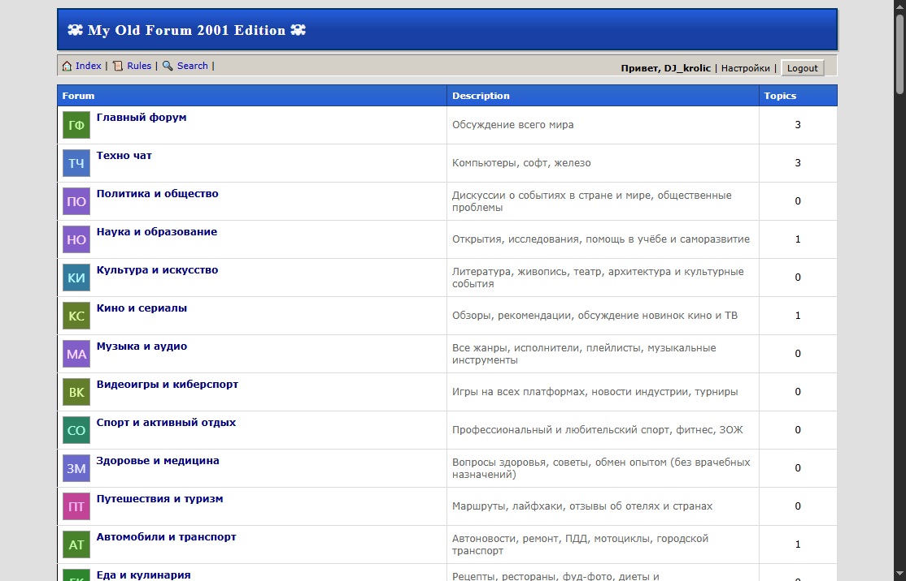

# My Old Forum 2001 Edition 🖥️

Ностальгический движок форума в стиле Windows 98/2001, работающий на edge-инфраструктуре Cloudflare.

**v2 — vBulletin/IPB Edition**: движок переработан до функциональности классических vBulletin и IPB начала 2000-х.

---

## ✨ Возможности

**Структура форума (как в vBulletin)**
- Категории → форумы, статистика по каждой (темы/сообщения/последнее сообщение)
- Темы: префиксы, закреплённые 📌, объявления 📢, закрытые 🔒, счётчик просмотров, пагинация
- Опросы: создание вместе с темой, голосование, результаты с полосками

**Общение**
- Личные сообщения: входящие/исходящие, счётчик новых в шапке
- Репутация: 👍/👎 с комментарием, журнал на профиле, защита от накрутки (1 раз в сутки)
- Цитаты и мульти-цитаты, быстрый ответ
- Вложения через R2: картинки, видео, аудио, документы, архивы (до 50 MB)
- Аватары (загрузка до 1 MB), подписи, контакты, «откуда», дата рождения

**BBCode (полный набор)**
`[b]` `[i]` `[u]` `[s]` `[color]` `[size]` `[quote=Автор]` `[code]` `[spoiler]` `[list]` `[url]` `[img]` `[hr]` + авто-встраивание YouTube и текстовые смайлы (`:)` `:D` `:cool:` …). Панель кнопок редактора.

**Группы и модерация**
- Роли: Администратор / Модератор / Пользователь / Забанен (цветные ники, звёзды за сообщения)
- Инструменты модератора: закрепить, закрыть, сделать объявлением, перенести, удалить тему; правка/удаление любых сообщений
- Предупреждения с баллами, бан/разбан, смена роли
- Админ-панель `/admin`: категории, форумы, пользователи, статистика

**Сообщество**
- Список участников с сортировкой и поиском
- Поиск: по словам, автору, форуму, только в названиях тем, «Новые за 24 часа»
- «Кто в онлайне» + рекорд онлайна, дни рождения, статистика форума
- Звания по числу сообщений (Новичок → Мега Писатель), свой титул с 100 сообщений

**Безопасность**
- Сессии в D1 с продлением, CSRF-токены на всех формах, рейт-лимит на логин/регистрацию/посты, экранирование вывода, проверка прав на сервере

---

## 🚀 Быстрый старт

### 1. Создайте D1 базу в Cloudflare
1. Зайдите в [Cloudflare Dashboard](https://dash.cloudflare.com/) → **D1**
2. Нажмите **Create database** → имя `forum-db`

### 2. Создайте воркер
1. Перейдите в **Workers & Pages** → **Create application** → Worker с именем `forum`
2. В настройках воркера (Settings → Bindings) добавьте:
   - **D1**: Variable name `DB` → база `forum-db`
   - **R2** (для вложений и аватаров): Variable name `FORUM_R2_BUCKET` → ваш бакет
3. Compatibility date: `2024-09-23` или новее

### 3. Задеплойте движок

**Вариант А — с демо-данными (рекомендуется для знакомства)**
1. Замените код воркера на содержимое `initializatorDB.js` и задеплойте
2. Откройте `https://forum.ваш-аккаунт.workers.dev/?secret=mysupersecretkey`
   *(Вы должны увидеть: `Database initialized successfully!`)*
3. Замените код на содержимое `worker.js` и задеплойте

**Вариант Б — чистая установка**
1. Сразу задеплойте `worker.js`
2. Схема создастся автоматически при первом запросе
3. **Первый зарегистрированный пользователь автоматически становится администратором**

### 4. Готово! 🎉
Откройте форум: `https://forum.ваш-аккаунт.workers.dev`

---

## 👤 Тестовые аккаунты

Только после запуска `initializatorDB.js`:

| Логин | Пароль | Роль |
| :--- | :--- | :--- |
| `Admin` | `admin123` | Администратор |
| `Moderator` | `mod123` | Модератор |
| `dev` | `dev123` | Пользователь |

> ⚠️ Смените пароли демо-аккаунтов после первого входа.

---

## 🛠 Обновление с v1

База данных мигрируется **автоматически и без потери данных**: при первом запросе новой версии движок аддитивно добавит недостающие таблицы (категории, ЛС, репутация, предупреждения, опросы) и колонки. Существующие темы, сообщения и пользователи сохраняются; пользователю `Admin` и `Moderator` автоматически назначаются роли.

---

## 📦 Стек
- **Cloudflare Workers** — весь бэкенд одним файлом
- **Cloudflare D1** — SQLite-база (пользователи, форумы, темы, посты, ЛС, опросы, репутация…)
- **Cloudflare R2** — файловое хранилище вложений и аватаров
- Ноль зависимостей: чистый ES-модуль без сборки

---

## 👥 Авторы

- **larin-ilya** — идея и оригинальная версия форума
- **codex** — движок v2 «vBulletin/IPB Edition»: категории, опросы, ЛС, репутация, модерация, админ-панель, безопасность, тесты

Лицензия: MIT (см. [LICENSE](LICENSE)).
